# NF1.UD3 – Usuaris i grups

**Guia de l'activitat: configuració d'usuaris, grups i perfils a TechData S.L.**

- **Mòdul:** Sistemes operatius en xarxa – RA2
- **Sistema:** Ubuntu Server (`sox-MB`)
- **Alumne:** _(Marc Bruguera)_ – Núm. de llista: 02

---

## Introducció

L'empresa TechData S.L. ha instal·lat un servidor Ubuntu Server i cal preparar-hi l'estructura d'usuaris i grups per als departaments de Desenvolupament (`devs`), Sistemes (`sysadmin`) i per als auditors externs (`auditor`).

En aquesta guia es documenta, tasca per tasca, l'objectiu de cada acció, la comanda utilitzada, una explicació del seu funcionament, la captura del resultat i una comprovació final.

Abans de començar, convé recordar alguns conceptes:

- **Usuari:** entitat que representa una persona o un procés que pot accedir al sistema. Té un nom únic, un identificador d'usuari (UID) i un identificador de grup (GID).
  - **root** (UID 0): privilegis màxims.
  - **Usuaris del sistema** (UID < 1000): creats per a serveis i processos, sense inici de sessió interactiu.
  - **Usuaris normals** (UID ≥ 1000): persones reals, amb inici de sessió i shells com `/bin/bash`.
- **Grup:** col·lecció d'usuaris que comparteixen permisos. Cada grup té un GID únic. A Ubuntu, cada usuari normal té un grup primari amb el seu mateix nom i pot pertànyer a altres grups secundaris.
- A Ubuntu l'usuari root està deshabilitat per defecte, per això totes les tasques d'administració es fan amb `sudo`.

---

## Tasca 1. Creació de la jerarquia de grups

### Objectiu
Crear els grups `devs`, `sysadmin` i `auditor` i comprovar el GID que el sistema ha assignat a cadascun.

### Comandes
```bash
sudo groupadd devs
sudo groupadd sysadmin
sudo groupadd auditor
```

### Explicació
La comanda `groupadd` crea un grup nou. Com que no s'ha indicat cap GID amb l'opció `-g`, el sistema assigna automàticament el primer GID lliure a partir de 1000, ja que són **grups normals** (no s'ha fet servir `-r`, que crearia un grup del sistema amb GID inferior a 1000). Cal `sudo` perquè modificar els grups requereix privilegis d'administrador.

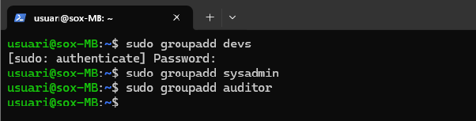

### Comprovació
Els grups es guarden al fitxer `/etc/group`. Amb `tail` en consultem les últimes línies:

```bash
tail /etc/group
```

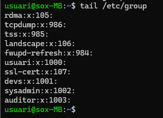

Cada línia té el format `nom:x:GID:membres`. Els GID assignats són:

| Grup | GID |
|---|---|
| devs | 1001 |
| sysadmin | 1002 |
| auditor | 1003 |

El camp de membres és buit perquè encara no hi ha cap usuari assignat com a membre secundari.

---

## Tasca 2. Gestió dels perfils d'usuari

### Objectiu
Fer que tots els usuaris nous tinguin automàticament un fitxer de benvinguda, una carpeta `Documents` i l'alias `ll`, modificant el directori plantilla `/etc/skel`.

Quan es crea un usuari, el sistema crea el seu directori d'inici (`/home/nom_usuari`) i hi copia el contingut de `/etc/skel`. Per tant, tot el que afegim a `/etc/skel` ho tindran tots els usuaris nous.

### 2.1 Fitxer de benvinguda

```bash
echo "Benvingut al servidor de TechData. Normes: no compartir la contrasenya, canviar-la periòdicament i fer un ús responsable dels recursos." | sudo tee /etc/skel/BENVINGUDA.txt
```

Es fa servir `tee` perquè `/etc/skel` necessita privilegis d'administrador. Amb el redirector `>` el `sudo` només s'aplicaria a `echo` i no a l'escriptura del fitxer. `tee` rep el text i l'envia alhora a la pantalla i al fitxer.

### 2.2 Carpeta Documents

```bash
sudo mkdir /etc/skel/Documents
```

### 2.3 Alias `ll`

```bash
sudo nano /etc/skel/.bashrc
```

Al final del fitxer s'afegeix:

```bash
# Alias personalitzat TechData
alias ll='ls -la --color=auto'
```

El fitxer `.bashrc` és l'adequat per definir àlies de comandes. El `.bashrc` original ja contenia un `alias ll='ls -alF'`, però com que el nou alias està definit més avall, és el que preval.

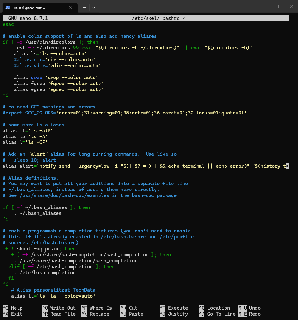

### Comprovació del contingut de /etc/skel

```bash
ls -A /etc/skel
```

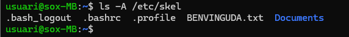

S'hi veuen els fitxers ocults per defecte (`.bash_logout`, `.bashrc`, `.profile`) i els elements nous: `BENVINGUDA.txt` i la carpeta `Documents`.

### 2.4 Shell per defecte a /etc/adduser.conf

```bash
sudo nano /etc/adduser.conf
```

S'ha comprovat que la variable `DSHELL` té el valor `/bin/bash`, que és la shell que `adduser` assigna als usuaris nous.

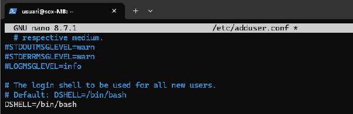

### 2.5 Prova amb l'usuari prova02

Es crea un usuari de prova amb `adduser`, que configura automàticament el directori d'inici, la shell i la contrasenya, guiant l'usuari pas a pas:

```bash
sudo adduser prova02
```

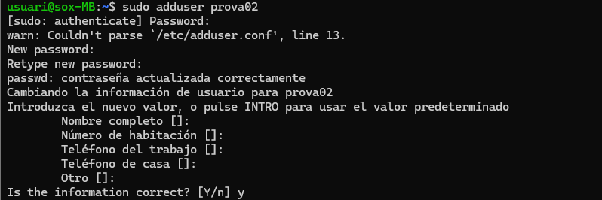

Després s'inicia sessió amb aquest usuari. S'utilitza `su -` (amb el guió) perquè carregui el seu entorn complet i ens situï al seu directori personal; sense el guió no es carregaria el `.bashrc` del nou usuari.

```bash
su - prova02
ls -la
ll
cat BENVINGUDA.txt
```

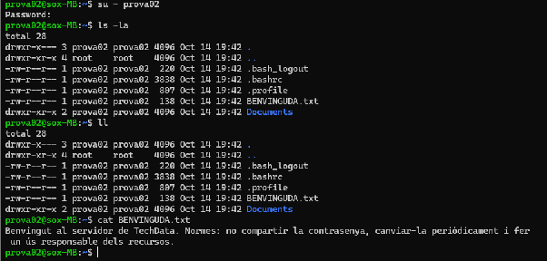

**Comprovació:**
- El directori `/home/prova02` conté `BENVINGUDA.txt` i la carpeta `Documents`, copiats de `/etc/skel`.
- La comanda `ll` mostra el mateix resultat que `ls -la`, per tant l'alias funciona.
- `cat` mostra el contingut del fitxer de benvinguda.

Finalment es torna a l'usuari administrador amb `exit` i s'elimina l'usuari de prova juntament amb el seu directori d'inici:

```bash
exit
sudo userdel -r prova02
```

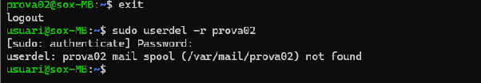

L'opció `-r` elimina també el directori d'inici. El missatge *mail spool not found* només indica que l'usuari no tenia bústia de correu; l'usuari s'ha eliminat correctament.

---

## Tasca 3. Creació i configuració d'usuaris

### Objectiu
Crear els usuaris de l'empresa amb el grup principal, els grups secundaris, el directori personal i la shell indicats a l'enunciat.

### 3.1 Usuaris de desenvolupament amb adduser

```bash
sudo adduser paul_dev
sudo adduser laura_dev
```

Durant el procés s'introdueix la contrasenya inicial `Canviam2026!` i el nom real de l'usuari.

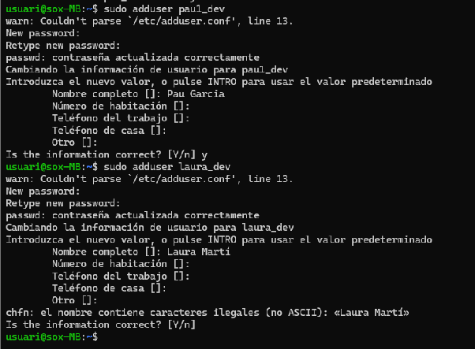

En el cas de `laura_dev`, el sistema no accepta el nom «Laura Martí» perquè conté un caràcter no ASCII (`í`), així que s'ha introduït com «Laura Marti».

Com que a Ubuntu `adduser` crea un grup propi amb el nom de l'usuari i el fa grup primari, cal canviar el grup principal a `devs` amb `usermod -g`:

```bash
sudo usermod -g devs paul_dev
sudo usermod -g devs laura_dev
```

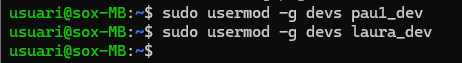

### 3.2 marc_sys i auditor amb useradd

`useradd` no configura res automàticament, per això cal indicar els paràmetres:

```bash
sudo useradd -m -s /bin/bash -g sysadmin -G devs -c "Marc Soler" marc_sys
sudo useradd -m -s /bin/bash -g auditor -c "Usuari Auditor" auditor
```

| Opció | Funció |
|---|---|
| `-m` | Crea el directori d'inici (`/home/usuari`) |
| `-s /bin/bash` | Defineix la shell per defecte |
| `-g` | Defineix el grup primari |
| `-G` | Afegeix l'usuari a grups secundaris |
| `-c` | Nom real de l'usuari |

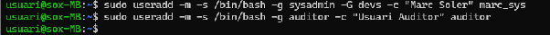

### 3.3 Contrasenyes

`useradd` no assigna contrasenya, de manera que s'estableix amb `passwd`. El sistema la demana dues vegades per verificar-la i la desa xifrada a `/etc/shadow`.

```bash
sudo passwd marc_sys
sudo passwd auditor
```

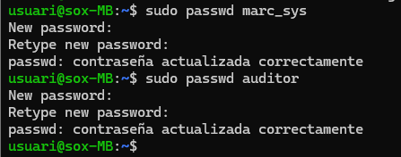

### 3.4 Obligar a canviar la contrasenya

```bash
sudo passwd -e paul_dev
```

L'opció `-e` fa expirar la contrasenya i obliga l'usuari a canviar-la en el pròxim inici de sessió.

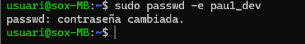

**Comprovació:** en iniciar sessió com a `paul_dev`, el sistema indica que cal canviar la contrasenya immediatament i en demana una de nova.

```bash
su - paul_dev
```

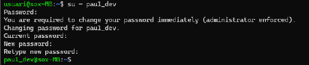

### 3.5 Comprovació general a /etc/passwd

```bash
tail /etc/passwd
```

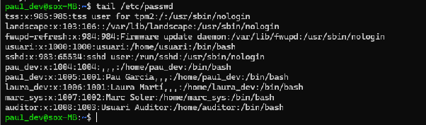

Cada línia té el format `nom:x:UID:GID:nom real:directori:shell`:

| Usuari | UID | GID (grup) | Directori | Shell |
|---|---|---|---|---|
| paul_dev | 1005 | 1001 (devs) | /home/paul_dev | /bin/bash |
| laura_dev | 1006 | 1001 (devs) | /home/laura_dev | /bin/bash |
| marc_sys | 1007 | 1002 (sysadmin) | /home/marc_sys | /bin/bash |
| auditor | 1008 | 1003 (auditor) | /home/auditor | /bin/bash |

Tots els usuaris tenen UID superior a 1000 (usuaris normals), el grup principal correcte i la shell `/bin/bash`.

---

## Tasca 4. Inspecció del sistema i fitxers de configuració

### Pregunta 1. UID, GID i grups de marc_sys

```bash
id marc_sys
```

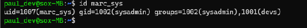

`id` mostra l'UID, el GID i els grups d'un usuari:

- **UID:** 1007
- **GID (grup primari):** 1002 (`sysadmin`)
- **Grups:** 1002 (`sysadmin`) i 1001 (`devs`) com a grup secundari

### Pregunta 2. /etc/passwd vs /etc/shadow i permisos

```bash
grep paul_dev /etc/passwd
ls -l /etc/shadow
```

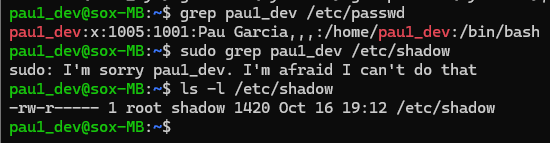

> La consulta a `/etc/shadow` amb `sudo` falla en aquesta captura perquè s'estava treballant com a `paul_dev`, que no té permisos d'administrador. La línia de `paul_dev` a `/etc/shadow` es pot veure a les captures de la Tasca 5, fetes des de l'usuari administrador.

**Diferència entre els dos fitxers:**

- **`/etc/passwd`** conté la informació general de l'usuari: nom, UID, GID, nom real, directori d'inici i shell. La contrasenya no hi apareix; en el seu lloc hi ha una `x`.
- **`/etc/shadow`** conté la contrasenya xifrada amb un algorisme de hash i els paràmetres de caducitat. La línia té aquests camps:
  - nom d'usuari;
  - contrasenya xifrada (`$algorisme$sal$hash`). La sal és una cadena aleatòria que fa que dues contrasenyes iguals generin hashes diferents;
  - data de l'últim canvi en dies des de l'1 de gener de 1970;
  - mínim de dies abans de poder-la canviar (`0`);
  - màxim de dies de validesa (`99999` = no expira mai);
  - dies d'avís abans de l'expiració (`7`);
  - camps per a la desactivació i l'expiració del compte.

**Permisos de /etc/shadow:** `-rw-r----- root shadow`. Només el propietari (root) hi pot escriure i, a part del grup `shadow`, ningú més el pot llegir. Això és així perquè conté els hashes de les contrasenyes: si qualsevol usuari els pogués llegir, podria intentar endevinar-les amb atacs de diccionari o de força bruta.

### Pregunta 3. Directori plantilla

```bash
grep SKEL /etc/adduser.conf
```

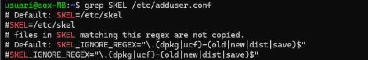

El directori plantilla és **`/etc/skel`**. Quan es crea un usuari, el seu contingut es copia al seu directori `/home`. Aquesta configuració es defineix a la variable `SKEL` del fitxer **`/etc/adduser.conf`** (valor per defecte `SKEL=/etc/skel`), que és el fitxer de configuració de la comanda `adduser`.

---

## Tasca 5. Manteniment, bloqueig i eliminació

### 5.1 Bloquejar el compte de paul_dev

**Objectiu:** impedir temporalment que el treballador iniciï sessió mentre és de vacances.

```bash
sudo passwd -l paul_dev
sudo grep paul_dev /etc/shadow
```

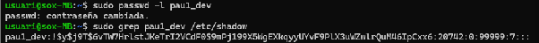

L'opció `-l` bloqueja la contrasenya. A `/etc/shadow` es veu que al camp de la contrasenya s'hi ha afegit un **`!`** davant del hash, cosa que fa que la contrasenya deixi de ser vàlida.

### 5.2 Comprovar l'estat i desbloquejar

```bash
sudo passwd -S paul_dev
sudo passwd -u paul_dev
sudo grep paul_dev /etc/shadow
```

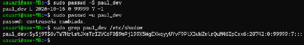

- `passwd -S` mostra l'estat: la **`L`** indica que el compte està bloquejat (*locked*), seguida de la data de l'últim canvi i dels paràmetres de caducitat.
- `passwd -u` desbloqueja la contrasenya. A `/etc/shadow` el hash torna a aparèixer sense el `!`, és a dir, l'usuari pot tornar a iniciar sessió amb la seva contrasenya.

### 5.3 Eliminar l'usuari auditor

**Objectiu:** donar de baixa l'auditor extern, incloent-hi el directori personal i la bústia de correu.

```bash
sudo userdel -r auditor
grep auditor /etc/passwd
ls /home
```

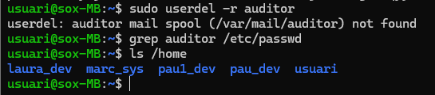

**Comprovació:**
- `userdel -r` elimina l'usuari i el seu directori d'inici. El missatge *mail spool (/var/mail/auditor) not found* indica que l'usuari no tenia cap bústia de correu creada, per tant no n'hi havia cap per eliminar.
- `grep auditor /etc/passwd` no retorna res: l'usuari ja no existeix.
- `ls /home` ja no mostra el directori `auditor`.

El grup `auditor` continua existint, ja que l'enunciat només demana eliminar l'usuari.

---

## Tasca 6. Personalització de l'entorn d'usuari

### Objectiu
Instal·lar la shell `fish` i assignar-la com a shell per defecte de `laura_dev`. La shell per defecte dels usuaris nous ja es va definir a la Tasca 2; ara es modifica la d'un usuari concret amb `usermod -s`.

### 6.1 Instal·lació de fish

```bash
sudo apt update
sudo apt install fish
```

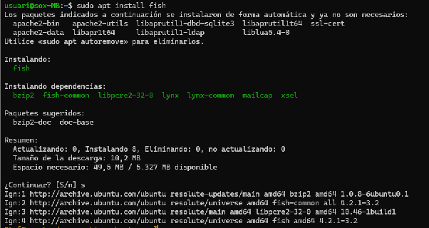

### 6.2 Canvi de shell de laura_dev

Primer cal conèixer la ruta de l'executable de fish i després assignar-la amb `usermod -s`, que canvia la shell per defecte d'un usuari:

```bash
which fish
sudo usermod -s /usr/bin/fish laura_dev
grep laura_dev /etc/passwd
```


**Comprovació:** l'últim camp de la línia de `laura_dev` a `/etc/passwd` ha de ser la ruta de fish.

### 6.3 Inici de sessió com a laura_dev

```bash
su - laura_dev
echo $SHELL
```


**Comprovació:** en iniciar sessió amb `su -` es carrega l'entorn complet de l'usuari i apareix el prompt de fish, diferent del de bash. Amb `exit` es torna a l'usuari administrador.

---

## Conclusió

S'ha configurat l'estructura d'usuaris i grups del servidor de TechData:

- S'han creat els grups `devs`, `sysadmin` i `auditor`.
- S'ha personalitzat la plantilla `/etc/skel` perquè tots els usuaris nous tinguin el fitxer de benvinguda, la carpeta `Documents` i l'alias `ll`, i s'ha comprovat amb un usuari de prova.
- S'han creat els usuaris amb `adduser` i `useradd`, s'han assignat els grups principals i secundaris i les contrasenyes, i s'ha obligat un usuari a canviar-la.
- S'ha analitzat la informació de `/etc/passwd`, `/etc/shadow` i `/etc/group`.
- S'ha bloquejat, desbloquejat i eliminat usuaris de manera segura.
- S'ha canviat la shell d'un usuari a `fish`.
